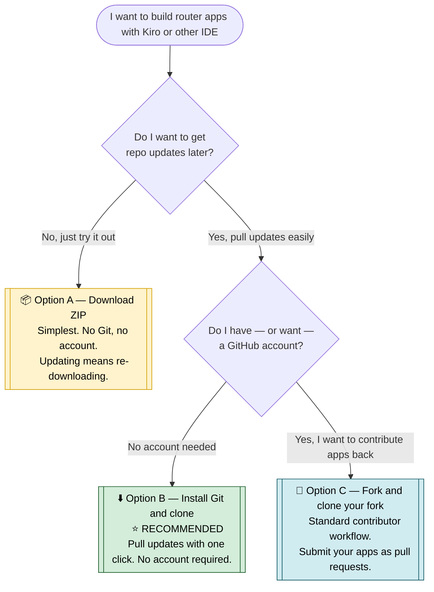

# Ericsson Cradlepoint NCOS SDK

**Extend your Ericsson routers with custom Python applications.**

The NCOS SDK enables developers to build and deploy Python applications that run directly on Ericsson Cradlepoint NetCloud OS (NCOS) routers. Create custom logic for connectivity management, IoT data collection, monitoring, automation, and more—without replacing hardware.

---

## Ready-to-Use Built Apps

Pre-built application packages (`.tar.gz`) ready to install on your router are available at:

**[Download Built Apps](https://github.com/cradlepoint/sdk-samples/releases/tag/built_apps)**

These are compiled from the sample apps in this repository and can be installed via NetCloud Manager's Tools page without any development setup.

---

## Development Environment Setup

### Quick setup

```bash
git clone https://github.com/cradlepoint/sdk-samples.git
cd sdk-samples
```

**Windows:**

```cmd
python setup_env.py
```

**macOS / Linux:**

```bash
python3 setup_env.py
```

---

### Detailed Setup Instructions

There are three ways to set it up. Use the flowchart to find the one that fits, then open the
matching section below for step-by-step instructions. **Every option gets you to the same
place:** Kiro (or other IDE) open on this repo, a working `.venv`, and your dev router configured.

> New to all this? **Option B is recommended.** It is barely more work than a plain download
> and it lets you pull updates later with one click.

### Which option is right for me?



**At a glance:**

| | Option A — ZIP | Option B — Clone ⭐ | Option C — Fork + clone |
|---|---|---|---|
| Need Git installed | No | Yes | Yes |
| Need a GitHub account | No | No (needed only to contribute) | Yes |
| Pull updates later | Re-download | One click in Kiro | One click in Kiro |
| Contribute apps back | No | Yes — needs a GitHub account (`make.py contribute` makes a fork for you) | Yes |
| Best for | A quick look | **Most users** | Regular contributors |

Pick an option below and follow its steps.

---

### Option A — Download the ZIP

<details>
<summary><b>📦 Simplest. No Git and no GitHub account. Click to expand.</b></summary>

Best if you just want to try the apps and don't mind manual updates.

#### 1. Install Python

**Windows:** Download Python 3 from [python.org/downloads](https://www.python.org/downloads/).
Run the installer and **check "Add python.exe to PATH"** on the first screen, then click
**Install Now**. Open a **new** terminal and verify with `python --version`.

<details>
<summary>🪟 Windows: detailed Python setup &amp; PATH troubleshooting (click if <code>python</code> isn't found)</summary>

> **Why can I double-click .py files but `python` doesn't work in the terminal?**
> This usually means Python was installed from the Microsoft Store, which registers file
> associations but doesn't always add Python to your system PATH. Follow the steps below to fix it.

1. **Uninstall existing Python (recommended).** Open **Settings → Apps → Installed apps**, search
   for **Python**, and uninstall any entries (including any **Python Launcher**).
2. **Download.** Go to [python.org/downloads](https://www.python.org/downloads/) and click the
   large **Download Python 3.x.x** button.
3. **Install.** Right-click the installer and **Run as administrator**. On the very first screen
   check **both** boxes: **"Use admin privileges when installing py.exe"** and
   **"Add python.exe to PATH"** (this is the critical step). Click **Install Now**, and if you see
   a **Disable path length limit** option at the end, click it.
4. **Verify.** Close and reopen your terminal (PATH changes don't apply to open windows), then run
   `python --version` and `pip --version`.
5. **If `python` still isn't found:** open **Settings → Environment Variables → Edit the system
   environment variables → Environment Variables**, select **Path** under **System variables**,
   and confirm these two entries exist (version may differ):
   - `C:\Users\<YourUsername>\AppData\Local\Programs\Python\Python3xx\`
   - `C:\Users\<YourUsername>\AppData\Local\Programs\Python\Python3xx\Scripts\`
6. **If `python` opens the Microsoft Store:** open **Settings → Apps → Advanced app settings →
   App execution aliases** and turn **OFF** both **App Installer - python.exe** and
   **App Installer - python3.exe**.
7. **If `pip` is not recognized:** run `python -m ensurepip --upgrade`.

</details>

**macOS:** Install with [Homebrew](https://brew.sh/) (`brew install python3`) or download from
[python.org/downloads](https://www.python.org/downloads/). Verify with `python3 --version`.

#### 2. Download and unzip the repo

- Go to [github.com/cradlepoint/sdk-samples](https://github.com/cradlepoint/sdk-samples).
- Click **Code ▸ Download ZIP**.
- Unzip it somewhere easy to find, e.g. `C:\sdk-samples` or `~/sdk-samples`.

#### 3. Run setup from the terminal

Open a terminal in the unzipped folder and run:

**Windows**

```powershell
python setup_env.py
```

**macOS / Linux**

```bash
python3 setup_env.py
```

This creates the `.venv` virtual environment, installs the Python dependencies, points the
editor's interpreter at `.venv`, and then asks for your dev router's **IP, username, and
password** (reply `skip` to do that later). It finishes by checking the router connection and
Developer Mode. Re-run anytime with `python setup_env.py --configure` to change router settings.

#### 4. Install Kiro (or other IDE) and sign in

1. Download Kiro from [kiro.dev](https://kiro.dev/) and run the installer.
2. When Kiro asks you to sign in, choose one of:
   - **Ericsson employees — organization identity.** Click **"Sign in with your organization
     identity"**. On the next page, **do not enter your email address** — click the link below
     that reads **"Sign in via IAM Identity Center instead"**, then enter the **Start URL** and
     **Region** your IT department gave you.
   - **Everyone else — social login.** Sign in with a Google account to try Kiro for free
     (50 credits over 30 days).
3. To switch accounts later, click the account icon at the bottom of the left sidebar, sign out,
   and sign back in.

Then, in Kiro (or other IDE), choose **Open a Project** (or **File ▸ Open Folder**), select the
unzipped folder, and click **"Yes, I trust the authors"** when prompted.

#### Getting updates later

There is no one-click update on a ZIP download. To update:

1. Move your own app folders (under `apps/`) somewhere safe.
2. Download and unzip the latest ZIP.
3. Copy your app folders back in.

If you would rather update with one click, use **Option B** instead.

</details>

---

### Option B — Install Git and clone ⭐ Recommended

<details>
<summary><b>⬇️ Pull updates with one click. No GitHub account needed. Click to expand.</b></summary>

Best for most users. One extra tool (Git) gives you painless updates, and you can still
contribute apps back later without setting up a fork by hand.

#### 1. Install Python

**Windows:** Download Python 3 from [python.org/downloads](https://www.python.org/downloads/).
Run the installer and **check "Add python.exe to PATH"** on the first screen, then click
**Install Now**. Open a **new** terminal and verify with `python --version`.

<details>
<summary>🪟 Windows: detailed Python setup &amp; PATH troubleshooting (click if <code>python</code> isn't found)</summary>

> **Why can I double-click .py files but `python` doesn't work in the terminal?**
> This usually means Python was installed from the Microsoft Store, which registers file
> associations but doesn't always add Python to your system PATH. Follow the steps below to fix it.

1. **Uninstall existing Python (recommended).** Open **Settings → Apps → Installed apps**, search
   for **Python**, and uninstall any entries (including any **Python Launcher**).
2. **Download.** Go to [python.org/downloads](https://www.python.org/downloads/) and click the
   large **Download Python 3.x.x** button.
3. **Install.** Right-click the installer and **Run as administrator**. On the very first screen
   check **both** boxes: **"Use admin privileges when installing py.exe"** and
   **"Add python.exe to PATH"** (this is the critical step). Click **Install Now**, and if you see
   a **Disable path length limit** option at the end, click it.
4. **Verify.** Close and reopen your terminal (PATH changes don't apply to open windows), then run
   `python --version` and `pip --version`.
5. **If `python` still isn't found:** open **Settings → Environment Variables → Edit the system
   environment variables → Environment Variables**, select **Path** under **System variables**,
   and confirm these two entries exist (version may differ):
   - `C:\Users\<YourUsername>\AppData\Local\Programs\Python\Python3xx\`
   - `C:\Users\<YourUsername>\AppData\Local\Programs\Python\Python3xx\Scripts\`
6. **If `python` opens the Microsoft Store:** open **Settings → Apps → Advanced app settings →
   App execution aliases** and turn **OFF** both **App Installer - python.exe** and
   **App Installer - python3.exe**.
7. **If `pip` is not recognized:** run `python -m ensurepip --upgrade`.

</details>

**macOS:** Install with [Homebrew](https://brew.sh/) (`brew install python3`) or download from
[python.org/downloads](https://www.python.org/downloads/). Verify with `python3 --version`.

#### 2. Install Git

- **Windows:** Download **Git for Windows** from
  [git-scm.com/download/win](https://git-scm.com/download/win) and install it (the default
  options are fine).
- **macOS:** install with Homebrew, or run `git --version` once and accept the prompt to install
  Apple's command line tools:

  ```bash
  brew install git
  ```

#### 3. Clone the repo and run setup

Open a terminal and run these in order. The clone needs no GitHub sign-in — this repo is public.

**Windows**

```powershell
git clone https://github.com/cradlepoint/sdk-samples.git
cd sdk-samples
python setup_env.py
```

**macOS / Linux**

```bash
git clone https://github.com/cradlepoint/sdk-samples.git
cd sdk-samples
python3 setup_env.py
```

`setup_env.py` creates `.venv`, installs dependencies, points the editor's interpreter at
`.venv`, then asks for your dev router's **IP, username, and password** (reply `skip` to do it
later) and checks the connection and Developer Mode.

#### 4. Install Kiro (or other IDE) and sign in

1. Download Kiro from [kiro.dev](https://kiro.dev/) and run the installer.
2. When Kiro asks you to sign in, choose one of:
   - **Ericsson employees — organization identity.** Click **"Sign in with your organization
     identity"**. On the next page, **do not enter your email address** — click the link below
     that reads **"Sign in via IAM Identity Center instead"**, then enter the **Start URL** and
     **Region** your IT department gave you.
   - **Everyone else — social login.** Sign in with a Google account to try Kiro for free
     (50 credits over 30 days).
3. To switch accounts later, click the account icon at the bottom of the left sidebar, sign out,
   and sign back in.

Then, in Kiro (or other IDE), choose **Open a Project** (or **File ▸ Open Folder**), select the
`sdk-samples` folder you just cloned, and click **"Yes, I trust the authors"** when prompted.

#### Getting updates later

In Kiro, click the **Synchronize Changes** button (the circular-arrows icon) in the bottom-left
status bar. That pulls the latest changes into your clone. (From a terminal, the equivalent is
`git pull`.)

#### Contributing apps back (optional)

**You will need a GitHub account to contribute** — the free one from
[github.com/signup](https://github.com/signup) is fine. You do **not** need to fork first.
Once you have an app you want to share, run:

**Windows**

```powershell
.venv\Scripts\python make.py contribute my_app
```

**macOS / Linux**

```bash
.venv/bin/python3 make.py contribute my_app
```

`make.py contribute` creates your fork automatically, pushes your app, and opens a pull request.
It installs the GitHub CLI for you on first run and signs you in with `gh auth login`.

</details>

---

### Option C — Fork and clone your fork

<details>
<summary><b>🍴 The standard contributor workflow. Needs a GitHub account. Click to expand.</b></summary>

Best if you plan to contribute apps regularly and want your own copy of the repo on GitHub.

#### 1. Create a GitHub account

If you don't already have one, sign up free at
[github.com/signup](https://github.com/signup).

#### 2. Install Python and Git

**Python — Windows:** Download Python 3 from
[python.org/downloads](https://www.python.org/downloads/). Run the installer and
**check "Add python.exe to PATH"** on the first screen, then click **Install Now**. Open a
**new** terminal and verify with `python --version`.

<details>
<summary>🪟 Windows: detailed Python setup &amp; PATH troubleshooting (click if <code>python</code> isn't found)</summary>

> **Why can I double-click .py files but `python` doesn't work in the terminal?**
> This usually means Python was installed from the Microsoft Store, which registers file
> associations but doesn't always add Python to your system PATH. Follow the steps below to fix it.

1. **Uninstall existing Python (recommended).** Open **Settings → Apps → Installed apps**, search
   for **Python**, and uninstall any entries (including any **Python Launcher**).
2. **Download.** Go to [python.org/downloads](https://www.python.org/downloads/) and click the
   large **Download Python 3.x.x** button.
3. **Install.** Right-click the installer and **Run as administrator**. On the very first screen
   check **both** boxes: **"Use admin privileges when installing py.exe"** and
   **"Add python.exe to PATH"** (this is the critical step). Click **Install Now**, and if you see
   a **Disable path length limit** option at the end, click it.
4. **Verify.** Close and reopen your terminal (PATH changes don't apply to open windows), then run
   `python --version` and `pip --version`.
5. **If `python` still isn't found:** open **Settings → Environment Variables → Edit the system
   environment variables → Environment Variables**, select **Path** under **System variables**,
   and confirm these two entries exist (version may differ):
   - `C:\Users\<YourUsername>\AppData\Local\Programs\Python\Python3xx\`
   - `C:\Users\<YourUsername>\AppData\Local\Programs\Python\Python3xx\Scripts\`
6. **If `python` opens the Microsoft Store:** open **Settings → Apps → Advanced app settings →
   App execution aliases** and turn **OFF** both **App Installer - python.exe** and
   **App Installer - python3.exe**.
7. **If `pip` is not recognized:** run `python -m ensurepip --upgrade`.

</details>

**Python — macOS:** Install with [Homebrew](https://brew.sh/) (`brew install python3`) or download
from [python.org/downloads](https://www.python.org/downloads/). Verify with `python3 --version`.

**Git:** [git-scm.com/download/win](https://git-scm.com/download/win) on Windows (default options
are fine), or `brew install git` on macOS.

#### 3. Fork the repo

- Go to [github.com/cradlepoint/sdk-samples](https://github.com/cradlepoint/sdk-samples).
- Click **Fork** (top right) and create the fork under your account.

#### 4. Clone your fork and run setup

Replace `YOUR-USERNAME` with your GitHub username.

**Windows**

```powershell
git clone https://github.com/YOUR-USERNAME/sdk-samples.git
cd sdk-samples
python setup_env.py
```

**macOS / Linux**

```bash
git clone https://github.com/YOUR-USERNAME/sdk-samples.git
cd sdk-samples
python3 setup_env.py
```

`setup_env.py` creates `.venv`, installs dependencies, points the editor's interpreter at
`.venv`, then asks for your dev router details and checks the connection and Developer Mode.

#### 5. Install Kiro (or other IDE) and sign in

1. Download Kiro from [kiro.dev](https://kiro.dev/) and run the installer.
2. When Kiro asks you to sign in, choose one of:
   - **Ericsson employees — organization identity.** Click **"Sign in with your organization
     identity"**. On the next page, **do not enter your email address** — click the link below
     that reads **"Sign in via IAM Identity Center instead"**, then enter the **Start URL** and
     **Region** your IT department gave you.
   - **Everyone else — social login.** Sign in with a Google account to try Kiro for free
     (50 credits over 30 days).
3. To switch accounts later, click the account icon at the bottom of the left sidebar, sign out,
   and sign back in.

Then, in Kiro (or other IDE), choose **Open a Project** (or **File ▸ Open Folder**), select the
cloned folder, and click **"Yes, I trust the authors"** when prompted.

#### Getting updates later

In Kiro, click the **Synchronize Changes** button (the circular-arrows icon) in the bottom-left
status bar to pull from your fork. To also pull the latest changes from the original repo, add it
as a remote once in a terminal:

```bash
git remote add upstream https://github.com/cradlepoint/sdk-samples.git
git pull upstream master
```

#### Contributing apps back

With a fork and a GitHub account you can submit pull requests the standard way, or let
`make.py contribute my_app` handle the branch, push, and PR for you.

</details>

---

### After setup — a quick check

Whichever option you chose, you are ready when:

- `setup_env.py` finished without errors and created `.venv`.
- Kiro (or other IDE) is open on the `sdk-samples` folder and you have signed in.
- Your dev router is configured in `sdk_settings.ini` (or you chose to `skip` for now).
- **Developer Mode is enabled** for your router in NetCloud Manager under
  **Tools ▸ Developer Mode Devices**. This cannot be enabled from the router's own UI, and
  deploys are rejected without it.

Then open the Kiro (or other IDE) chat panel and describe what you want to build — for example,
*"Build a web app that shows WAN status and signal strength for all modems."*

---

## Resources

| Resource | Link |
|----------|------|
| **SDK Developer Guide** | [docs/NCOS_SDK_Developer_Guide.md](docs/NCOS_SDK_Developer_Guide.md) |
| **cp.py Methods Reference** | [docs/cp_methods_reference.md](docs/cp_methods_reference.md) |
| **NetCloud Manager — SDK apps** | [Tools Tab](https://docs.cradlepoint.com/r/NetCloud-Manager-Tools-Tab) |
| **Third-Party Licenses** | [THIRD-PARTY-LICENSES.md](THIRD-PARTY-LICENSES.md) |

---

## Repository Structure

```
├── apps/                   # Sample applications, and where your new apps are created
│   ├── 5GSpeed/            # Each app is a self-contained folder
│   ├── hello_world/        # with package.ini, start.sh, readme.md, etc.
│   ├── mqtt_app/
│   ├── ...                 # 75+ apps total
│   ├── templates/          # app_template, web_app_template
│   └── archive/            # Retired/inactive apps
├── docs/                  # API documentation
├── make.py                # Build/deploy tool
└── sdk_settings.ini       # Router connection settings
```

Apps are categorized using the `tags` field in their `package.ini` (e.g., `tags = connectivity, speedtest`).

---

## Usage — make.py

```bash
# Create a new app (created in apps/, path printed when done)
python3 make.py create my_app

# Build a single app (searches apps/ recursively)
python3 make.py build my_app

# Build all apps
python3 make.py build all

# Deploy to connected router (purge + build + install + start)
python3 make.py deploy my_app

# Check status
python3 make.py status my_app
```

| Action | Description |
|--------|-------------|
| **create** | Scaffold a new app from `app_template` into `apps/<name>/` |
| **build** | Package an app as `.tar.gz` for deployment |
| **deploy** | Full lifecycle: purge → build → install → verify |
| **status** | Show app state on the connected router |
| **start / stop** | Control a running app |
| **uninstall** | Remove app from router |
| **clean** | Remove local build artifacts |
| **contribute** | Fork, branch, commit, push, and open a PR for one app |

---

## Usage Agreement

Ericsson Enterprise Wireless Solutions, Inc. has no obligation under this Agreement to provide support, maintenance, updates, or upgrades for the SDK. Company may modify, deprecate, or discontinue the SDK or any feature at any time. THE SDK IS PROVIDED "AS IS" AND "AS AVAILABLE," WITHOUT WARRANTY OF ANY KIND. TO THE MAXIMUM EXTENT PERMITTED BY APPLICABLE LAW, COMPANY DISCLAIMS ALL WARRANTIES, EXPRESS, IMPLIED, OR STATUTORY, INCLUDING IMPLIED WARRANTIES OF MERCHANTABILITY, FITNESS FOR A PARTICULAR PURPOSE, TITLE, AND NON-INFRINGEMENT, AND ANY WARRANTY ARISING FROM COURSE OF DEALING OR USAGE OF TRADE. TO THE MAXIMUM EXTENT PERMITTED BY APPLICABLE LAW, COMPANY WILL NOT BE LIABLE FOR ANY INDIRECT, INCIDENTAL, SPECIAL, CONSEQUENTIAL, OR EXEMPLARY DAMAGES, OR FOR LOST PROFITS, REVENUE, DATA, OR GOODWILL, ARISING OUT OF OR RELATED TO THIS AGREEMENT OR THE SDK, EVEN IF ADVISED OF THE POSSIBILITY OF SUCH DAMAGES. COMPANY'S TOTAL AGGREGATE LIABILITY ARISING OUT OF OR RELATED TO THIS AGREEMENT WILL NOT EXCEED USD $100. 