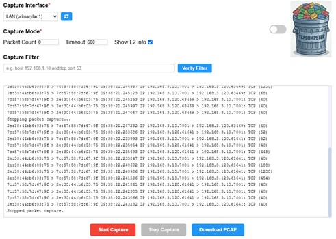
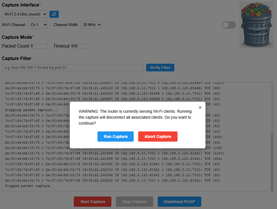
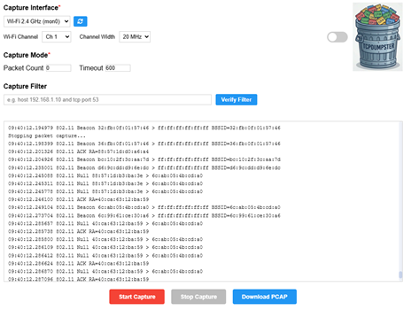
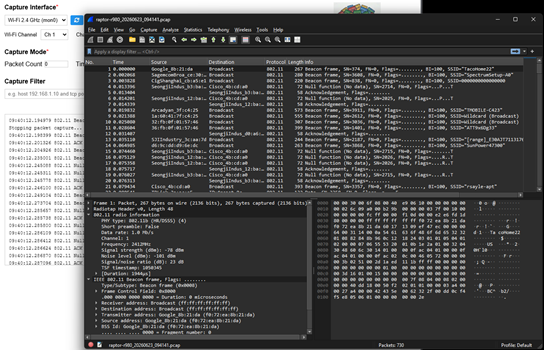

# tcpdumpster

Graphical packet capture interface for Ericsson Cradlepoint routers. Runs as an
NCOS SDK application and provides an HTML-based UI for defining capture parameters,
monitoring live results, and downloading PCAP files.

## Examples

  <a href="./static/tcpdumpster-LAN.png">
  
  
  

## Features

- Live packet display with decoded summaries
- Web UI on the port shown in the app log and saved in `tcpdumpster_web_port` (usually 7001)
- Interface selection (WAN, LAN, Wi-Fi monitor, SDWAN)
- Only displays active interfaces
- Refresh for newly activated interfaces
- Configurable packet count and timeout
- BPF capture filter support and verification
- L2 header toggle
- PCAP file download
- Light and dark mode UI toggle

## Usage

Access the UI at `http://<router_ip>:<port>` after deploying. The port is shown
in the app log and saved in `tcpdumpster_web_port` (usually 7001, or the next
free port if 7001 is taken). The startup log shows it, for example
`Bound port 7001 (discovered, saved to tcpdumpster_web_port)` then
`Web server started on port 7001`.

Ensure firewall zone forwarding is configured from Primary LAN Zone to
Router Zone to allow LAN clients to reach the app's web port.

To change the port for one router or a group, set `tcpdumpster_web_port` in
NCM SDK Data (device or group) and restart the app. Delete the field and
restart to go back to automatic selection. A configured port that is busy is
retried for about 10 seconds. If the port is not a number from 1 to 65535, or
stays busy, the app stops itself and logs why. Fix or delete the field, then
start the app.

## Requirements

- NCOS 7.x or later
- Zone forwarding enabled so LAN clients can reach the app's web port

## Appdata Fields

| Field | Required | Description |
|-------|----------|-------------|
| `tcpdumpster_web_port` | No | Web UI port (1-65535). If set, the app uses exactly this port. If not set, it uses the first free port from 7001 and saves it here. Delete it to pick a port automatically again. |

## Notes

- The Wi-Fi Channel and Channel Width options are only shown when a Wi-Fi
  monitor interface is selected
- Automatically places Wi-Fi radios in monitor mode as necessary.  Returns the radios to their previous state when capture completes.
- L2 header toggle does not apply to Wi-Fi captures since they are inherently L2 frames.
- Capture filter verification does not process Wi-Fi specific filters.